# MOHD REHAN KHAN

### `BCA Student` · `Python Developer` · `Aspiring AI/ML Engineer`

  
  

---

## `01 / ABOUT ME`

I'm a Bachelor of Computer Applications (BCA) student passionate about software development, data analytics, and artificial intelligence. I enjoy building practical projects, exploring new technologies, and solving real-world problems through code.

- 🔭 **Currently working on:** Python projects and web development
- 🌱 **Currently learning:** Python, Data Structures & Algorithms, SQL, and Data Analytics
- 🤝 **Open to:** Open-source contributions and collaborative projects
- 🎯 **Career Goal:** Become an AI/ML Engineer
- 💬 **Ask me about:** Python, web development, and coding resources
- ⚡ **Fun Fact:** I love turning complex problems into simple solutions!

## `02 / RESUME`

---

## `03 / TECH STACK`

### Programming Languages

### Data Analytics & Visualization

### Web Development & Tools

---

## `04 / FEATURED PROJECTS`

### 📊 [EduMetricsPro — Student Performance Analytics](https://github.com/red-khann/edumetricspro)

An academic data analytics project focused on exploring student performance and presenting insights through data visualization.

- Student performance analysis
- Interactive data visualizations
- Data analysis using Python

**Technologies:** Python, Pandas, Plotly

[Explore the repository](https://github.com/red-khann/edumetricspro)

### 🏢 [RISA Interior & Contractors](https://www.risainterior.in/)

A business website for an interior design and contracting company, designed to showcase its services and establish its online presence.

- Business website development
- User interface and responsive design
- Online presentation of company services

**Technologies:** Next.js, React, TypeScript, Tailwind CSS, Supabase

[Visit the live website](https://www.risainterior.in/)

### 🌦️ Weatherly — Weather Application

A lightweight weather application built with Flask and the Open-Meteo API, featuring city search and weather information.

- City search and suggestions
- Weather data through an API
- Responsive, clean interface

**Technologies:** Python, Flask, HTML, CSS, JavaScript, Open-Meteo

[Find Weatherly in my repositories](https://github.com/red-khann?tab=repositories)

---

## `05 / GITHUB STATISTICS`

 

---

## `06 / CONNECT WITH ME`

---

⭐ *Thanks for visiting my profile! Feel free to explore my projects and connect with me.*

Always learning. Always building.

