# MOHD REHAN KHAN

### `Python Developer` · `BCA Student` · `Aspiring AI/ML Engineer`

  
  

---

## `01 / ABOUT ME`

- 🎓 BCA student interested in software development and AI/ML.
- 🐍 Building with Python and learning by creating practical projects.
- 🧩 Interested in data, automation and problem-solving.
- 🌱 Currently strengthening Python, SQL, DSA and machine-learning foundations.
- 🎯 Long-term goal: become an AI/ML Engineer.

 

## `02 / SELECTED PROJECTS`

<table>
<tr>
<td width="50%">
  
</td>
<td width="50%">
  
</td>
</tr>
<tr>
<td colspan="2">
  
</td>
</tr>
</table>

> Project links will be changed to the exact repository URLs once the repositories are confirmed.

## `03 / TECH TOOLKIT`

## `04 / GITHUB`

 

---

**Thanks for visiting!**  
Always learning. Always building.

